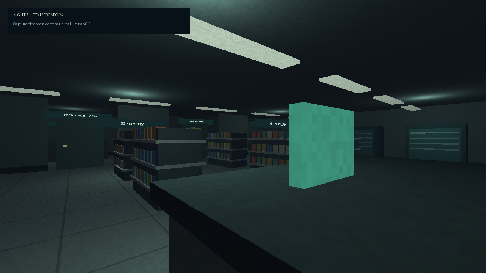

# NIGHT SHIFT — Android 0.1

Primeira versão single-player do Mercado 24 Horas, conforme a etapa 31 do escopo.
Um survival horror psicológico em primeira pessoa, offline, com geometria 3D real
renderizada em WebGL e um host Android nativo WebView. Não é um vídeo ou cenário
sem interação. Não utiliza Unity ou Godot. Não precisa de conta, servidor ou internet.


## Downloads

- [APK Android](dist/Night-Shift-Android.apk?raw=true)
- [Projeto completo em ZIP](dist/Night-Shift-Projeto.zip?raw=true)
- [HTML offline](dist/Night-Shift.html?raw=true)



Os arquivos prontos estão em `dist/`. Para gerar um novo APK com o SDK Android,
abra **Actions → Build Night Shift APK → Run workflow**; depois baixe o artifact
**Night-Shift-APK** da execução concluída.

## Entregas

- **Night-Shift-Android.apk**: build de desenvolvimento assinado v1 + v2, Android
  8.0/API 26 ou superior, alvo API 35. APK universal Java, compatível com ARM64.
- **Night-Shift.html**: a mesma versão empacotada em um HTML offline único para
  abrir em um navegador com WebGL; em celulares, gire para landscape.
- **Night-Shift-Projeto.zip**: código do jogo, projeto Android, pipeline GitHub
  Actions e testes. Os arquivos de assinatura privados não são incluídos.

**Limite de validação:** estrutura, assinaturas e integridade do APK foram verificadas
independentemente. Não foi instalado em emulador ou celular físico. O objetivo de
30/60 FPS precisa ser medido em aparelhos reais. A versão ainda precisa de testes
reais de touchscreen, áudio e ciclo de vida do WebView antes de uma publicação.

## Jogar

1. Instale o APK e abra Night Shift. A orientação do aplicativo é horizontal.
2. Escolha Novo turno; os turnos duram 12, 15 ou 18 minutos.
3. Abra CELULAR → Tarefas. Há cinco trabalhos: organizar bebidas, limpar uma
   mancha, transportar uma caixa do depósito ao balcão, verificar CAM 03 e
   trancar a porta dos fundos. A ordem da lista muda a cada turno.
4. Joystick à esquerda para andar. Arraste sobre o cenário para olhar.
   USAR interage com o objeto à frente; CORRER é mantido pressionado.
5. LUZ alterna a lanterna. Na MOCHILA, toque em uma bateria para recarregar.
6. Relate a categoria e o local de uma anomalia ativa no celular. Acertos geram
   bônus no pagamento. A opção Errada não concede bônus.
7. Se a energia cair, encontre o quadro no escritório. Ligue os três interruptores
   na ordem **I / O / I** e toque em Religar. Pesadelo exige o fusível do banheiro.
8. Durante uma caça: apague a lanterna e use o armário da sala dos funcionários,
   ou permaneça imóvel por 5 segundos, a mais de 2 metros da presença.
9. Complete as tarefas e chegue às 06:00. O dia clareia e o pagamento é salvo.

O celular, inventário e minigame **não pausam** o relógio. O menu Pausa pausa.
Trocar de aplicativo pausa e tenta salvar o turno. O save periódico ocorre a cada
15 segundos, e também em interações relevantes. Limpar os dados do aplicativo ou
desinstalá-lo pode apagar o progresso. Não há sincronização em nuvem.

No navegador em computador: WASD; arrastar o mouse para olhar; E usar; F lanterna;
P celular; I mochila; Shift correr; Esc pausa. Todos os comandos têm botão por toque.

## Sistemas implementados

| Sistema | Comportamento na versão 0.1 |
|---|---|
| Mercado | estacionamento, caixa, prateleiras, geladeiras, depósito, banheiro, funcionários, escritório/CFTV, lixo e fundos |
| Portas | animação de abertura, bloqueio de passagem fechada, trava dos fundos |
| Tarefas | 5 tarefas, execução com feedback, transporte com condição de entrega |
| Anomalias | biblioteca de 16 eventos; 7/10/13 no máximo por turno; restrições de noite, horário, mapa, energia e eventos já utilizados |
| Watcher | observação, aproximação quando não observado, caça limitada e desaparecimento; navegação em grade com colisões |
| Câmeras | 5 pontos de vista reais do mesmo mundo, ~5 FPS, sinal condicionado à energia, figura exclusiva do CFTV |
| Energia | queda, puzzle dos interruptores, fusível exigido em Pesadelo |
| Lanterna | cone de iluminação, consumo lento, reposição de bateria |
| Inventário | 6 espaços; chave, cartão, ferramentas, caixa, baterias e fusível |
| Progressão | dinheiro, XP, noites, bônus de relatório e duas melhorias compráveis |
| História | mensagens por hora e registro escondido no escritório |
| Resultados | vitória, derrota por captura, tarefas pendentes; pagamento e XP |
| Save | progresso, configurações e turno em andamento; chave principal e backup local |
| Interface | menu, pausa, créditos, seleção, configurações, mochila e celular |
| Configurações | resolução, distância, 30/60 FPS, volume, sensibilidade, escala e opacidade dos botões |
| Finais | 3 epílogos simples após a Noite 5, conforme registros/pista; final verdadeiro ainda não implementado |

Os cinco locais adicionais, seus eventos próprios, narrativa completa, cosméticos
mais elaborados e final verdadeiro **não estão implementados**. A progressão atual
continua no Mercado; não mostra os outros locais como jogáveis. As noites seguintes
liberam eventos de níveis 2 e 3. Não há multiplayer, apenas separação dos sistemas
para permitir evolução futura.

## Tecnologia e otimização

- Geometria estática dividida em blocos, um buffer por bloco, descarte por distância
  e por direção; poucos draw calls. Não há occlusion culling completo.
- Produtos agrupados; NPCs reutilizados; buffer dinâmico reaproveitado.
- Um atlas de placas por mapa. Materiais procedurais; nenhum download de textura.
- Iluminação aproximada por superfície com 6 lâmpadas, cone da lanterna e neblina.
  Não há mapas de sombras nem opção de sombras: estão ausentes nesta versão.
- Câmeras atualizadas a 5 FPS; HUD a ~6 FPS; caminho da entidade recalculado com
  intervalo de 1,5 segundo e limite de busca, apenas quando necessário.
- Áudio ambiente e efeitos sintetizados localmente via Web Audio. Não são gravações
  profissionais de foley, voz ou música. Sem violência gráfica.
- Presets Baixo/Médio/Alto mudam resolução, distância e limite de FPS.
- Não exige ou solicita permissão INTERNET.

## Arquitetura

`engine.js`: Renderer, Geometry, World, matrizes, colisões e geometria.

`systems.js`: EventBus, PlayerController, TouchControls, InteractionSystem,
TaskManager, NightManager, AnomalyManager, EntityAI, CameraSystem, PowerSystem,
InventorySystem, SaveSystem e AudioManager.

`game.js`: GameManager, UIManager, ciclo do jogo e telas.

Para adicionar uma anomalia, acrescente seus metadados a `NS.ANOMALIES` e implemente
os efeitos de início/fim no AnomalyManager e a representação no World. Os campos
são `id`, `name`, `category`, `level`, `chance`, `from`, `to`, `maps`, `danger`,
`zone`, `condition` e `duration`.

O EventBus comunica horários, tarefas e eventos. Single-player é a única autoridade
atual. Uma expansão cooperativa precisará de transporte de rede, autoridade do
servidor, replicação, propriedade de objetos e saves próprios; não basta conectar
o EventBus à internet.

## Build Android padrão

Use JDK 17, Android SDK Platform 35, Build Tools 35.0.0 e Gradle 8.9.

```sh
cd android
# Configure sdk.dir em local.properties, ou ANDROID_HOME.
gradle :app:assembleDebug
```

Saída: `android/app/build/outputs/apk/debug/app-debug.apk`.
O workflow `.github/workflows/android.yml` faz a mesma compilação e fornece o
artifact Night-Shift-APK quando o projeto é enviado a um repositório GitHub e o
workflow é executado. Repositório: https://github.com/toastbyday/Night-shift.

A build padrão **não foi executada** aqui: o SDK Android não estava disponível.
O APK entregue foi gerado por `tools/offline_apk.py`, um empacotador específico
para o pequeno host desta versão. Ele não compila Java arbitrário: gera DEX do
host conhecido, manifesto binário e assinaturas usando Python + cryptography.
Se mudar MainActivity.java, use a build Gradle padrão ou atualize o empacotador.

O APK possui assinatura de desenvolvimento. Para uma publicação, utilize sua
própria chave de assinatura e a build padrão. Builds com certificados diferentes
não podem atualizar diretamente a mesma instalação.

## Verificações executadas

```sh
node tests/systems.test.cjs
python3 tests/render.py
python3 tests/apk.verify.py
```

Dependências de teste Python: `numpy`, `Pillow`, `moderngl`, `androguard`, `cryptography`.
O jogo e o aplicativo não utilizam essas dependências.

Os testes simulam um turno completo de 12 minutos e verificam colisões, portas,
entrada de toque, tarefas, transporte, relatórios, energia, dificuldade, esconderijo,
captura, retomada, pausa, recompensas e impossibilidade de pagamento duplicado.
Também verificam que os objetos essenciais podem ser mirados de posições livres.
Isso não equivale a testar os gestos reais num aparelho.

A captura de cenário foi renderizada via EGL/llvmpipe com a geometria e o shader
reais. Não é uma captura do aplicativo no Android. O teste do APK valida manifesto,
DEX, CRC do ZIP, os assets correspondentes ao código, assinaturas v1 e v2 e o digest
do pacote inteiro. Não comprova execução no Android.
